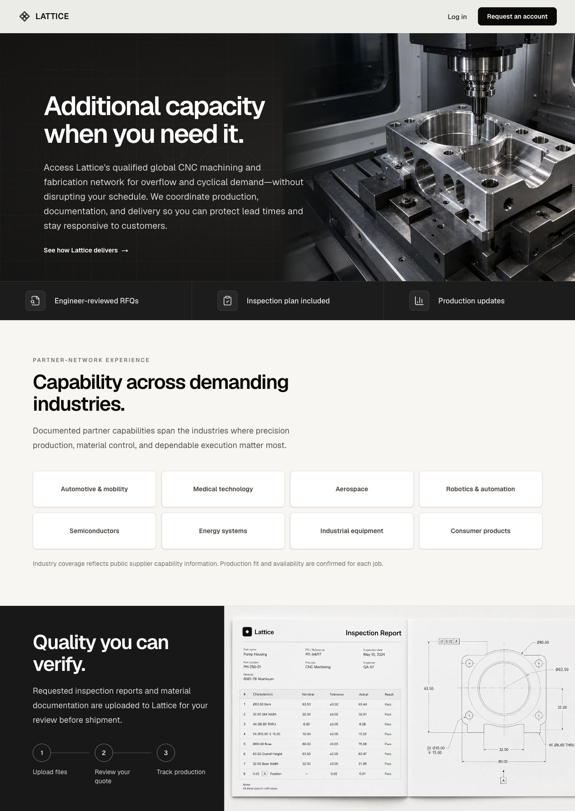

# Lattice Classic — Before Call-First Redesign

Archived October 22, 2026, at William’s request before publishing the new homepage.

## Permanent copy

- Git tag: `archive/lattice-classic-before-call-first-2026-10-22`
- Original source commit: `d00832919193471d420565eb0de8690b6fbc27fd`
- [Browse archived source](https://github.com/willpaikstack/lattice/tree/archive/lattice-classic-before-call-first-2026-10-22)
- Previous Production deployment: `dpl_58KQzfcMb6dUDDkoz6y36S3UMHbe`
- Previous deployment hostname: `lattice-4pblhyxc2-willpaikstacks-projects.vercel.app` (Vercel authentication protection applies).
- Additional local public-page bundle: `output/qa/public-site-release-2026-10-22/lattice-classic-before-call-first-2026-10-22.tar.gz`. The remote Git tag is the durable cross-computer copy.

The tag holds the complete tracked repository as it existed before the call-first redesign. It includes the old homepage, public header, How it works, access/login/recovery pages and manufacturing imagery. Secrets and customer runtime data are not part of this archive.

## Recognizing this version

Dark charcoal machining hero headed “Additional capacity when you need it.” A light partner-network industry section follows. Header actions are Log in and Request an account. The page ends with “Quality you can verify” and inspection-report imagery. There is no Book a call primary action.

## Switching back later

Ask to restore **Lattice Classic — Before Call-First Redesign**. Prefer restoring the public-page design from the tag into a fresh review branch while keeping current framework security patches, authorization, customer data and subsequent app improvements. Do not reset the entire main branch or overwrite the live database. Update relevant homepage/access tests with the restored design.

Main public design sources are `src/app/page.tsx`, `src/components/public-site-header.tsx`, `src/components/public-entry.tsx`, `src/app/(workspace)/how-it-works/`, `src/app/waiting-list/page.tsx`, `src/app/login/[[...login]]/page.tsx`, `src/app/forgot-password/page.tsx`, `src/app/reset-password/page.tsx`, and `public/landing/`.

The old Vercel deployment is an additional rollback reference. Its bundled Next.js 16.4.0 now has known runtime advisories; a long-term return to this design should retain the patched dependency version rather than promote the vulnerable historical binary.
