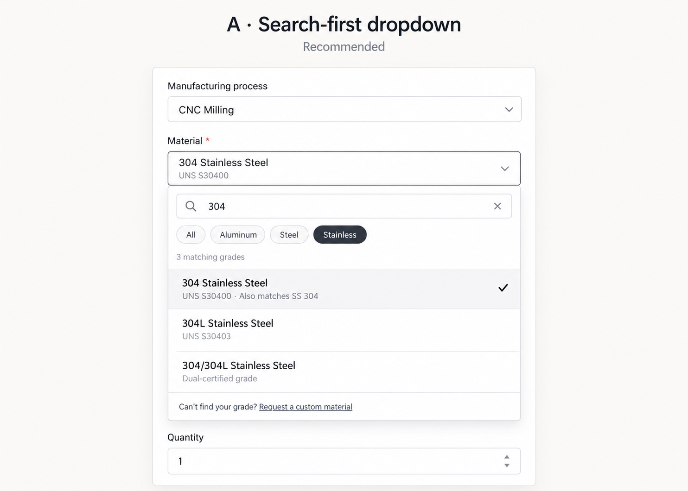
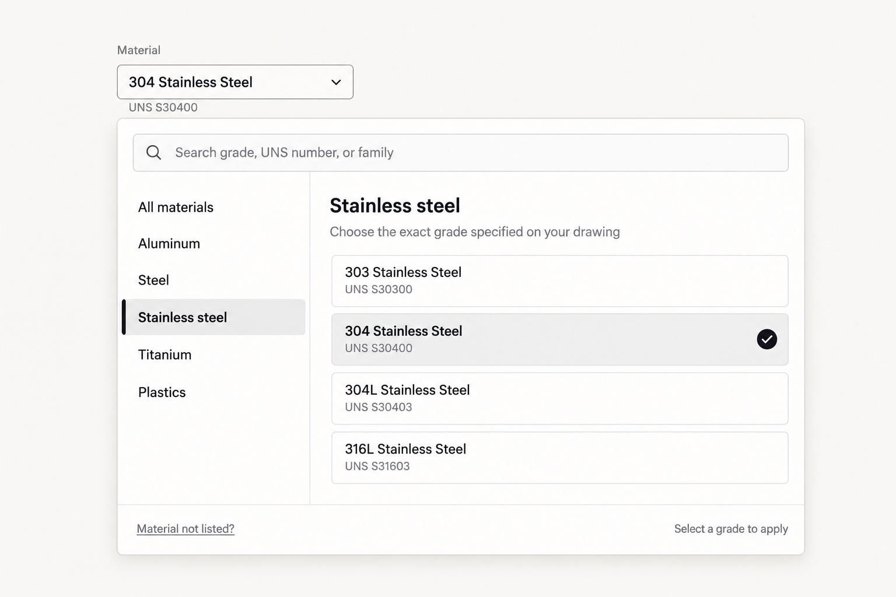
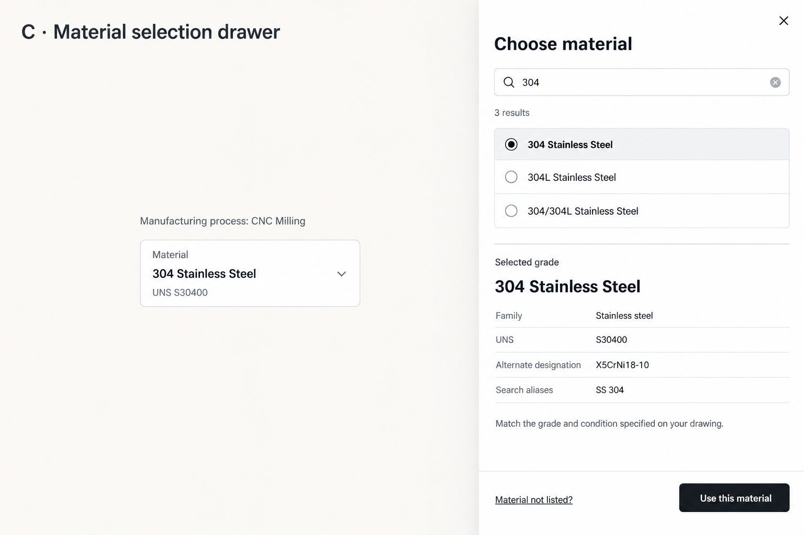

# Material selection UX audit — October 13, 2026

## Scope

Live desktop inspection of the current quote draft, plus MaterialSelect source inspection. Opened the menu, searched 304 and S30400, checked empty search and Escape. Existing 304 Stainless Steel selection was retained; no material was selected or RFQ submitted. No automated tests or mobile viewport checks ran. Generated concepts are proposals, not implemented UI or verified catalog records.

## What works

- New parts have no preselected material; existing explicit selections persist.
- Grade name, family and UNS/alternate designation are visible in the selected state.
- Search filters immediately; 304 and S30400 both found corresponding catalog entries in the live check.
- Family groups support browsing, and opening reveals the selected family. Group-open state persists during a session.
- Source provides arrow/Home/End/Enter navigation, active-row scrolling, selected-state styling, and outside/Escape closing.
- Material/process-aware finish validation provides a useful downstream constraint.

## Findings

| Priority | Finding | Evidence and user impact | Recommendation |
| --- | --- | --- | --- |
| High | Duplicate-looking aliases | Live 304 search returns both 304 Stainless Steel and SS 304 with identical UNS/formula. Buyers have no explanation of the difference. | Use a canonical selectable grade and searchable aliases after reviewing true equivalence. Keep 304L, dual-certified 304/304L and distinct tempers separate. Preserve historical selections during migration. |
| High | Search is brittle for common phrasing | Source uses a single lowercase substring over concatenated metadata. It does not normalize spacing/punctuation or independently match query tokens. | Support forms such as SS304 and stainless 304; rank exact grades/UNS ahead of broad family matches. Do not conflate grades because they share a search term. |
| Medium | Browsing can become a long nested list | The current session had Aluminum, Alloy steel and Stainless groups expanded. The menu is capped at 430px plus its search row. | Keep families easily accessible while showing a bounded grade list. Family chips or a family navigation column are alternatives. Avoid forcing every group closed if the user is comparing them deliberately. |
| Medium | No-results is a dead end | Live unmatched query shows only No materials found. | Add Clear search and Material not listed? with a reviewed custom-material request path. Do not silently select a substitute. |
| Medium | Focus is lost on Escape | Live Escape removed the search and focus returned to the page root, rather than the material trigger. | Restore trigger focus after Escape/selection; keep normal outside-click focus with the clicked control. |
| Medium | Search semantics are incomplete | Search input has no accessible name/combobox attributes; listbox wraps search and family controls. | Give search a clear accessible name and a consistent combobox/listbox pattern. Announce result count and no-results. |
| Medium | Similar grades need clearer differentiation | Names distinguish 304/304L/dual-certified, but repeated formula lines can be dense. Closed label/details use truncation. | Emphasize exact grade/temper; put aliases or identities in muted text, with fuller details on demand. Do not represent formulas/standards as an approved substitution rule. |
| Follow-up | Popup placement is not viewport-aware | Source uses an absolute downward popup within an overflow-hidden part card, unlike the new date-picker portal. No clipping occurred in the sampled desktop view. | Anchor a portal to field width, flip upward near viewport edges, and use a bounded list. Validate narrow screens separately. |

## Alternative designs

### A — Search-first dropdown (recommended)

Same-width dropdown with focused search, small family filters, short grade rows, selection checkmark and a custom-material recovery action. Alias consolidation and search normalization are part of the proposed data behavior, not just the appearance.

Best for buyers who already have a grade on their drawing. Preserves the existing form rhythm and immediate selection.

### B — Family browser

Wider desktop popover with family navigation at left and grades at right; global search across the top. On narrow screens it would need stacked family controls or a sheet.

Best for browsing an unfamiliar catalog. Requires more space and a deliberate mobile adaptation.

### C — Material selection drawer

Search/results plus a details preview and an explicit Use this material confirmation. Browsing does not immediately change the part.

Best when grade details/conditions need more room. Adds an extra confirmation and obscures more of the configuration page, so it is heavier for repeat expert buyers. The final concept intentionally omits unrelated website navigation.

## Recommendation

Choose A. Resolve duplicate aliases, query normalization, keyboard focus and custom-material recovery before spending effort on a larger catalog UI. Use B if customers primarily browse by family; reserve C for a materially richer grade-detail workflow.

Images were generated using the built-in imagegen tool. Their labels illustrate interaction design and require catalog review before implementation. No application changes were made.

## Follow-through — October 13, 2026

User authorized search normalization, explicit duplicate consolidation and procurement-support empty-state text. These are implemented in the RFQ picker via `rfq-material-search.ts`; five reviewed alias pairs are consolidated while historical catalog keys remain accepted. The user accepts existing Escape focus behavior. For long-list browsing, recommend an accordion with only one open family, a stationary search row and bounded scrolling; filters were declined and browsing changes remain recommendations.
